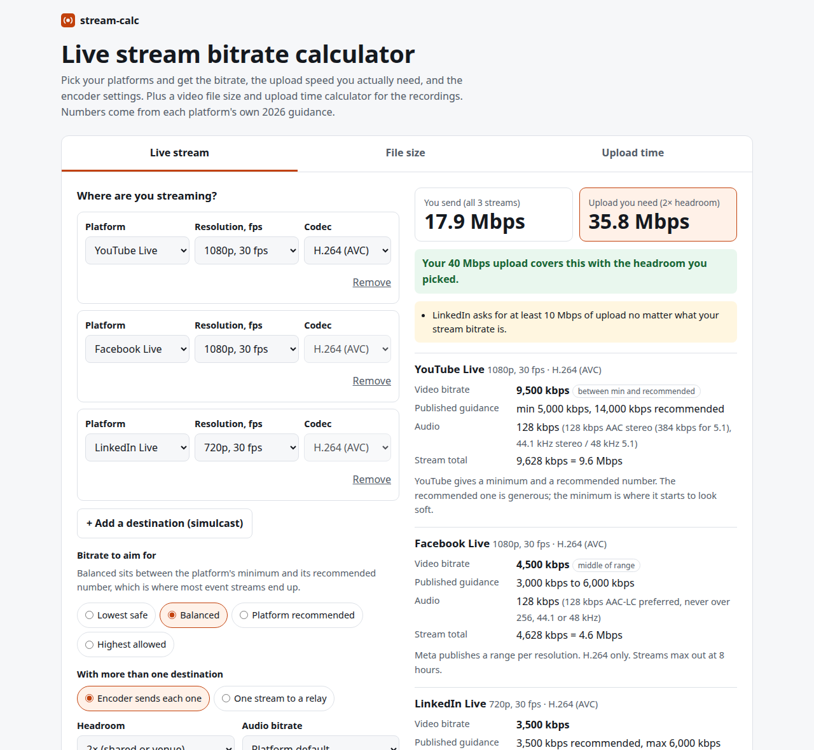

# stream-calc

**Live: https://lab.zalastack.com/stream-calc/**

A live stream bitrate calculator, plus a video file size and upload time calculator, for people who run streams at events.



I built this because every event stream I set up starts the same way: YouTube's encoder page in one tab, Meta's in another, LinkedIn's somewhere, a speed test, and a notes app to add it all up. Then someone asks how many drives we need for the camera ISOs. So now it's one page.

## What it does

- **Live stream planner.** Pick YouTube Live, Facebook Live, Twitch, LinkedIn Live, Vimeo, a Teams town hall (RTMP-In), Zoom to RTMP or a custom RTMP server. Set resolution, fps and codec (HEVC and AV1 only where the platform takes them). You get the video bitrate from the platform's own guidance, audio, the total, and the upload speed you need with headroom.
- **Simulcast.** Add destinations and see the total if your encoder sends each one, or the single stream if you push to a relay. It warns you when the relay feed is over a platform's cap (LinkedIn, I'm looking at you).
- **Encoder hints.** OBS and vMix settings that match the numbers: CBR, 2 s keyframe (and the GOP in frames), profile, B-frames, audio.
- **Video file size.** Duration + bitrate or a preset (ProRes 422 HQ / 422 / LT / Proxy, H.264 delivery, phone 4K) gives the size in GB and GiB. Reverse it to get the bitrate for a target size.
- **Event-day storage.** Recordings at once × hours × days × copies, and how many drives that is.
- **Upload time.** File size + upload speed, with a realistic efficiency factor and a table for common speeds.
- Share link (state lives in the URL hash), copy summary for the run sheet, remembers your last settings, light and dark mode.

## The 1.5 to 2× rule

Upload you need = (video + audio) × 1.5 at minimum, × 2 if the network is shared or it's a venue. Your connection has to hold the bitrate every second, not on average. Microsoft says the same in its Teams encoder guide: double the bitrate when sizing bandwidth.

## Privacy

Everything runs in your browser. No accounts, no analytics, no cookies, nothing sent anywhere. Your last inputs are kept in localStorage on your machine.

## How it works

Plain HTML, CSS and JavaScript, no build step, no dependencies. Platform numbers live in one object at the top of `app.js`. Where a platform gives a range and no single recommendation (Facebook), "Balanced" takes the middle; where it gives a minimum and a recommendation (YouTube), Balanced sits between them. Where a platform only publishes a ceiling (Teams), that's what you get, and it's labelled.

File size is bitrate × seconds ÷ 8, in decimal units (1 GB = 1,000,000,000 bytes), with binary GiB shown too.

## Run locally

```
git clone https://github.com/mizoz/stream-calc
cd stream-calc
python3 -m http.server
```

Then open http://localhost:8000.

## Sources

Last checked 2026-10-21.

- YouTube Live encoder settings, bitrates and resolutions: https://support.google.com/youtube/answer/2853702
- YouTube recommended upload encoding settings (used for the H.264 delivery presets): https://support.google.com/youtube/answer/1722171
- Meta Live Video API, video requirements: https://developers.facebook.com/docs/live-video-api/reference
- Twitch broadcasting guidelines: https://help.twitch.tv/s/article/broadcasting-guidelines
- Twitch, Dual Format and 2K streaming (June 17, 2026): https://blog.twitch.tv/en/2026/06/17/introducing-dual-format-and-2k-streaming-on-twitch/
- LinkedIn Live encoder settings: https://www.linkedin.com/help/linkedin/answer/a567498
- Vimeo recommended network configuration for live events: https://help.vimeo.com/hc/en-us/articles/12426939452817
- Microsoft Teams encoder configuration: https://learn.microsoft.com/microsoftteams/teams-encoder-configuration
- Microsoft Teams RTMP-In: https://learn.microsoft.com/microsoftteams/meetings-rtmp-in
- Zoom bandwidth (HD video upload): https://developers.zoom.us/docs/video-sdk/system-requirements/ and Zoom's system requirements help article
- Apple ProRes white paper (target data rates): https://www.apple.com/final-cut-pro/docs/Apple_ProRes.pdf

Not official, so labelled in the tool: the "Custom RTMP" numbers are my own working defaults, the phone presets are rough averages (about 170 MB a minute for 4K30 HEVC on an iPhone, 400 MB for 4K60), and the Zoom output resolution of 720p by default comes from Zoom's help docs, which I couldn't load directly this time. If a platform changes its numbers, open an issue.

## License

MIT. See [LICENSE](LICENSE).

Made by [Ahmed Mahmoud](https://lab.zalastack.com/) in Calgary. Other free tools: [social image sizer](https://lab.zalastack.com/social-image-sizer/), [UTM builder](https://lab.zalastack.com/utm-builder/), [post preview](https://lab.zalastack.com/post-preview/), [sponsorship builder](https://lab.zalastack.com/sponsorship-builder/).
